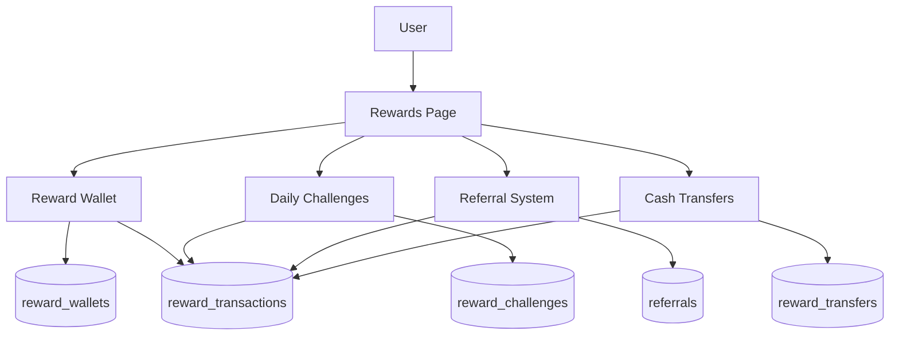

# FlowMint Rewards System — Implementation Summary

## 🏗️ Architecture Overview

## 📦 Files Created / Modified

### New Files
| File | Purpose |
|------|---------|
| `services/rewardService.ts` | Complete reward business logic — wallet, coins, cash, referrals, challenges |
| `components/Rewards.tsx` | Full rewards UI with 4 tabs (Overview, Earn, Transfer, History) |

### Modified Files
| File | Change |
|------|--------|
| `App.tsx` | Added `Tab.Rewards`, imported Rewards component, added to bottom nav & More menu |
| `components/UserProfile.tsx` | Connected Rewards stat card to live wallet data from DB |
| `types.ts` | Added `RewardWalletSummary` type |

## 🗄️ Database Tables (5 new tables, all with RLS)

| Table | Purpose |
|-------|---------|
| `reward_wallets` | Per-user wallet (coins, cash, streak, tier) |
| `reward_transactions` | Full audit log of every reward movement |
| `reward_challenges` | Daily tasks that earn coins |
| `referrals` | Referral code tracking & bonuses |
| `reward_transfers` | Cash transfer records (friend shares, donations) |

> **IMPORTANT:** All tables have **Row Level Security (RLS)** enabled. Users can only access their own data.
> A trigger auto-creates wallets for new profile signups.

## 🎮 Reward Algorithm

### Earning Flow Coins
| Action | Coins |
|--------|-------|
| Daily Login | 10 |
| Log Expense | 5 |
| Pay Bill | 15 |
| Complete Goal | 20 |
| Invite Friend | 100 |
| Check Credit Score | 10 |
| 7-Day Streak | 50 |
| 30-Day Streak | 200 |

### Tier System (based on lifetime coins)
| Tier | Min Coins | Badge |
|------|-----------|-------|
| 🥉 Bronze | 0 | Default |
| 🥈 Silver | 500 | |
| 🥇 Gold | 2,000 | |
| 💎 Platinum | 5,000 | |
| 👑 Diamond | 15,000 | |

### Cash Transfer Rules
1. **₹1,000 minimum** cash balance required to unlock transfers
2. Cash is earned via **friend donations** and **sharing**
3. Donors earn **bonus Flow Coins** (1 coin per ₹10 donated, max 50)
4. Transfers are processed via UPI
5. All transactions are securely recorded in `reward_transactions`

## 🎨 UI Features
- **Hero Wallet Card** — Animated background with floating coins, tier badge, streak counter
- **Daily Challenges** — 5 daily tasks with progress tracking
- **4-Tab Navigation** — Overview, Earn, Transfer, History
- **Referral System** — Copy/share referral codes
- **Tier Progress** — Visual bar showing progress to next tier
- **Transfer Modal** — Bottom sheet with success animations
- **Daily Reward Toast** — Auto-claimed with streak bonus notification
- **Transaction History** — Full log with earn/spend indicators
